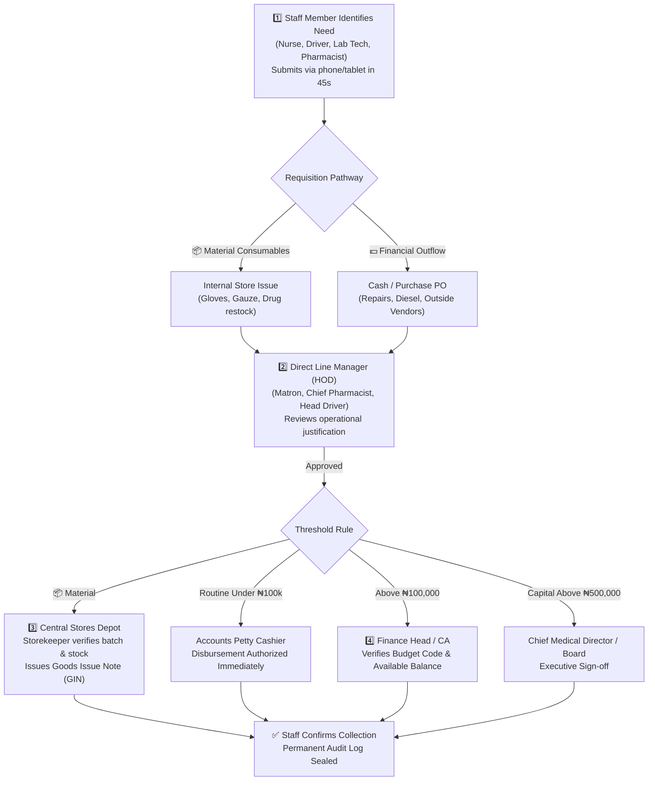

# 🏥 AMACREST HOSPITAL & MATERNITY
## Digital Requisition & Approval Management System (MedReq)
### Client Walkthrough Guide, Operational Review & Feedback Questionnaire

---

**Recipient:** The Chartered Accountant & Financial Controller, AMACREST Hospital & Maternity  
**Prepared by:** Engineering & Product Architecture Lead  
**Live Demo Prototype:** `https://amacrest-medreq.vercel.app` (or your shared Vercel link)  
**Date:** November 2026  

---

## 1. 🎯 Overview: Why We Built This Prototype

This prototype was developed specifically to demonstrate how **AMACREST Hospital & Maternity** can eliminate paper requisition memos, end clinical delays, stop unbudgeted financial leaks, and provide executive management with 100% real-time spending control.

Unlike generic corporate purchasing tools, this system addresses the **operational reality of a 24/7 hospital**:
- Wards cannot wait days for simple gloves or sterile gauze while patients are on admission.
- Ambulance drivers cannot be stranded when emergency tyre repairs or fuel vouchers are required.
- Central Stores must track consumable inventory without spending cash out of the hospital bank account.
- The Chartered Accountant must have **pre-spend budget enforcement** rather than discovering overspending at month-end.

---

## 2. 🗺️ Understanding the System Workflow (The 4-Step Chain)



### The 3 Core Rules Built into the Workflow:
1. **The Line Manager Rule:** Every request **must** originate and be approved by the staff's direct departmental HOD. The Board and Finance are not burdened with micro-approvals for routine items.
2. **The Dual Pathway Split:**
   - **Material Requisition (80% of volume):** Wards pulling consumables from Central Stores. *Zero cash is touched; warehouse stock is decremented.*
   - **Cash / Purchase Requisition (20% of volume):** External purchases, repairs, diesel. *Touches budget codes and Accounts Payable.*
3. **Automatic Value Escalation:** Routine expenses under ₦100,000 fly quickly; mid-tier expenses route to Finance; capital items over ₦500,000 auto-escalate to the Chief Medical Director.

---

## 3. 🔍 How to Test the Live Prototype (Quick Testing Guide)

To experience the platform as your staff, HODs, and finance team would:

1. **Visit the Demo Link** on your smartphone, tablet, or laptop.
2. Click **"Launch Workstation"** (or go to `/login`) to see the **One-Click Hospital Login Gateway**.
3. **Test as a Staff Member:**
   - Sign in as **Malam Ibrahim (Driver)** or **Nurse Fatima (Ward 3)**.
   - Click **`+ New Requisition`**.
   - Select your department, choose **Material** or **Cash**, pick an item (or tap **`+ Add Custom Item`** if unlisted), and click **Submit**.
4. **Test as a Department HOD:**
   - Sign in as **Dr. Chinedu Eze (Pharmacy HOD)** or **Malam Ibrahim (Transport HOD)** at `/hod`.
   - Observe that the inbox is strictly filtered to that HOD's department.
   - Click **`[Approve & Send to Store]`** or **`[Approve Disbursement]`** to see the interactive notification and status shift.
5. **Test Stores & Inventory:**
   - Go to `/inventory` to see the stock register, par-level alerts, and how opening balances are imported via Excel/CSV.
6. **Test the Finance Control Room:**
   - Go to `/finance` to see live departmental budget utilization bars and spend analytics.

---

## 4. 📝 Feedback & Operational Review Questionnaire
*(Please share your thoughts on these 6 operational points so we can fine-tune the final build to AMACREST Hospital's exact structure).*

### Q1: Departmental Structure & Hierarchy
- Are there specific departments or units currently missing from the prototype? *(e.g., Theatre, Dialysis Unit, Billing, NHIA Desk, Security?)*
- Does every department have a designated Line HOD who holds first-line approval authority?

### Q2: Financial Approval Thresholds
- In the prototype, we set routine approval at **₦100,000** (Line HOD), mid-tier at **₦100,000–₦500,000** (Finance/CA), and capital at **above ₦500,000** (CMD). 
- What are AMACREST Hospital's exact financial authorization limits?

### Q3: Cash vs. Material Handling
- How does the hospital currently handle petty cash disbursement for drivers and emergency maintenance? Is it cash at the cashier desk, staff account reimbursement, or corporate debit card?
- How does Central Stores currently track ward floor-stock replenishment?

### Q4: Pharmacy & Clinical Interlock
- Does AMACREST Hospital currently run an Electronic Medical Record (EMR) or Hospital Management System (HMS) for patient billing and consultation?
- Would you like MedReq to sync inventory with that system, or operate as a dedicated administrative procurement and stores platform?

### Q5: Out-of-Office & Delegation Policies
- When an HOD is in a 6-hour surgery, on night call, or on annual leave, who holds proxy approval rights? Should the system allow category-specific delegation (e.g. delegating consumable sign-off to a deputy nurse supervisor)?

### Q6: What Areas or Specific Pain Points Were Not Addressed?
- Are there unique administrative headaches, vendor payment disputes, or local hospital quirks you would like the production build to solve?

---

## 5. 🏗️ What is Involved in Building the Production-Grade System

Transitioning from this interactive frontend prototype to a **secure, hospital-grade enterprise system with a live backend and database** involves the following technical architecture:

```
┌────────────────────────────────────────────────────────┐
│                      FRONTEND LAYER                    │
│      Next.js 14 Responsive Web App + Mobile PWA        │
│   (Touch-optimized for Nurses' Tablets & Phones)       │
└───────────────────────────┬────────────────────────────┘
                            │ HTTPS / TLS 1.3
┌───────────────────────────▼────────────────────────────┐
│                   BACKEND & BUSINESS LOGIC             │
│        Node.js / Express or Nest.js REST API           │
│  - Multi-tier Approval State Machine                   │
│  - Automated Budget Enforcement Engine                 │
│  - SMS / Email Notification Dispatcher (Twilio/SMTP)   │
└───────────────────────────┬────────────────────────────┘
                            │ Prisma ORM
┌───────────────────────────▼────────────────────────────┐
│                    PRODUCTION DATABASE                 │
│         PostgreSQL Database (Relational & ACID)        │
│  - Encrypted User Accounts & Role-Based Access (RBAC)  │
│  - Immutable Audit Log Table (Append-only, no deletes) │
│  - Real-time Inventory & Stock Levels                  │
│  - Departmental Budget Ledgers & GL Cost Centers       │
└────────────────────────────────────────────────────────┘
```

### Key Technical Deliverables for Production:

1. **Production Database (PostgreSQL):**
   - High-concurrency relational database ensuring zero data loss (ACID compliant).
   - Dedicated schemas for Users, Roles, Department Budgets, Requisitions, Purchase Orders, Goods Received Notes (GRN), and Central Stores Inventory.
2. **Security & Data Sovereignty:**
   - **Role-Based Access Control (RBAC):** Strict permissions ensuring nurses cannot approve budgets, and drivers cannot view pharmacy ledgers.
   - **Tamper-Proof Audit Logging:** Every click, approval, rejection, and comment is permanently timestamped with the user's ID and IP address.
   - **Deployment Options:** Cloud-hosted on isolated virtual servers (AWS/DigitalOcean) or installed **on-premise** on AMACREST Hospital's local servers for complete data sovereignty.
3. **Multi-Channel Notification Gateway:**
   - Automated email alerts to HODs when a request is raised.
   - SMS notifications for urgent (STAT) emergency requests.
4. **Offline Resilience for Hospital Wards (PWA):**
   - Enables staff to draft requests even if local Wi-Fi fluctuates, auto-syncing once connectivity restores.

---

## 6. 🚀 Next Steps

1. **Review:** Kindly review the prototype and walkthrough with key management staff.
2. **Discovery Session (30 mins):** We schedule a brief alignment call to review your answers to the 6 questionnaire points above.
3. **Commercial Agreement & Deployment Roadmap:** We finalize the phased implementation schedule, milestone deliverables, and budget for the production deployment.

*We look forward to partnering with AMACREST Hospital & Maternity to build a paperless, transparent, and high-efficiency institution.*
