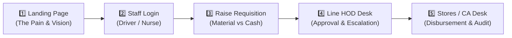

# 🏥 AMACREST HOSPITAL & MATERNITY
## MedReq Enterprise Requisition Protocol
### Executive Board Presentation Script & Live Demo Blueprint

---

> [!IMPORTANT]
> **Purpose of this Document:** This is your step-by-step master script for presenting to the **Chartered Accountant, Chief Medical Director (CMD), and Hospital Board of Directors**. Follow this exact sequence during your screen-share or projector demonstration.

---

## 1. 🎤 The Executive Opening (2 Minutes)
*(Deliver this before touching the laptop screen. Look directly at the Chartered Accountant and CMD).*

> *"Good afternoon, members of the Board and our Chief Financial Controller.*
>
> *Today, AMACREST Hospital loses hundreds of hours and millions of Naira to one invisible enemy: **the paper requisition memo**.*
>
> *When an ICU nurse needs emergency IV fluids, or an ambulance driver needs a blown tyre replaced, a paper form has to be hand-carried across corridors, waiting outside locked offices while approvers are in theatre or on ward rounds. Meanwhile, patients wait, ambulances are grounded, and by month-end, the Accounts department discovers millions in unbudgeted expenditures.*
>
> *We did not build another generic corporate app. We built **MedReq** — an operational nervous system designed specifically for how a hospital actually runs.*
>
> *It enforces three non-negotiable rules:*
> 1. ***Authority starts at the frontline Line Manager (HOD).***
> 2. ***Routine items fly immediately; high-value spending auto-escalates.***
> 3. ***Moving materials from your warehouse is completely separated from paying cash out of your bank account.***
>
> *Let me demonstrate how a real transaction moves across your hospital in 60 seconds."*

---

## 2. 🎬 Live Demonstration Sequence (Step-by-Step)



---

### Scenario A: The Ambulance Driver (Cash Petty Pathway)
**Goal:** Prove that frontline routine needs fly without bothering the Board, while keeping full financial records.

1. **Open:** Go to `/login`
2. **Action:** Click on **`Malam Ibrahim Musa (Ambulance Lead Driver)`** $\rightarrow$ Click **Sign In**.
3. **Show:** You are now in the Staff Portal. Click **`+ New Requisition`**.
4. **Fill:**
   - **Pathway:** Click **`💵 Financial Disbursement / Cash PO`**.
   - **Department:** Select `Transport & Logistics (Drivers)`.
   - **Urgency:** Select `Priority`.
   - **Items:** Add `Toyota HiAce Tyres` (₦42,000 $\times$ 2 = ₦84,000).
   - **What if it's unlisted?** Click **`+ Can't find item? Add Custom Item`** to show how unusual repairs are typed with an estimated price.
   - **Staff Justification:** *"Ambulance 2 scheduled for inter-state patient transfer tomorrow morning."*
   - Click **Submit Requisition**.
5. **Say to the Board:**
   > *"Malam Ibrahim did not leave the ambulance bay. The request is submitted in 45 seconds from his smartphone."*

---

### Scenario B: The Line HOD Authorization (`/hod`)
**Goal:** Show how HODs are isolated by department and how the Line Manager Threshold Rule works.

1. **Open:** Go to `/hod`
2. **Show the 7 Department Silos:**
   - Point out the department tabs: *Pharmacy, Nursing, Laboratory, Transport, Works & Engineering, Sanitation, Administration*.
   - Click **`🚐 Transport & Logistics (Malam Ibrahim Musa - Fleet Manager)`**.
   - **Highlight:** Only transport requests appear here. The Transport Manager never sees surgery gloves or drugs.
3. **The Approval Rule:**
   - Look at the ₦84,000 request just submitted.
   - **Highlight the Green Button:** It reads **`[Approve Disbursement]`**.
4. **Say to the Board:**
   > *"Because this routine maintenance is under ₦100,000, the Line HOD has the operational autonomy to clear it. It immediately authorizes the accounts cashier to disburse funds. No delay, no grounded ambulance."*
5. **Show High-Value Escalation:**
   - Switch to **`⚡ Works & Engineering (Engr. Bola Adewale)`**.
   - Look at the ₦890,000 generator overhaul request.
   - **Highlight:** The button changes to **`[Approve & Escalate]`**.
   - Click it $\rightarrow$ Show the toast notification: *"Escalated to Chief Medical Director & Chartered Accountant"*.

---

### Scenario C: The Ward Nurse & Clinical Consumables (Material Pathway)
**Goal:** Demonstrate that hospital consumables do not bleed cash — they move internally from Central Stores.

1. **Open:** Go to `/new-request`
2. **Fill:**
   - **Pathway:** Click **`📦 Internal Store Issue (Material)`**.
   - **Department:** `Nursing (Ward 3)`.
   - **Items:** `Latex Surgical Gloves (Box of 100)` $\times$ 10 boxes.
   - Click **Submit**.
3. **Switch to HOD:** Go to `/hod` $\rightarrow$ Click **`🩺 Clinical Nursing & Inpatient Wards (Matron Beatrice Alao)`**.
4. **Action:** Matron reviews the ward usage note $\rightarrow$ Clicks **`[Approve & Send to Store]`**.
5. **Say to the Board:**
   > *"Notice that this request never touched Finance. Zero cash is disbursed. It moves directly to the Central Stores depot for warehouse picking."*

---

### Scenario D: Central Stores & Opening Balance CSV Upload (`/inventory`)
**Goal:** Answer the question: *"How do we get all our thousands of hospital items into the system?"*

1. **Open:** Click **`Stores & Inventory (CSV)`** in the top navigation bar (`/inventory`).
2. **Show the Live Register:**
   - Point out the available stock, unit prices, and status badges (*In Stock, Low Stock, Out of Stock*).
   - Show the par-level warning badge on items approaching safety minimums.
3. **Show CSV Batch Upload:**
   - Click **`Download CSV Template`** $\rightarrow$ Show the pre-built Excel schema (`ItemCode, ItemName, Department, Quantity, UnitPrice, MinLevel`).
   - Click **`Import CSV File`** $\rightarrow$ Show simulated instant import of hundreds of line items in 1.2 seconds.
4. **Say to the Board:**
   > *"Onboarding your hospital doesn't take 6 months of typing. Each department exports their current Excel sheet into this template, uploads it, and your opening balances are live immediately."*

---

### Scenario E: The Chartered Accountant's Control Room (`/finance` & `/reports`)
**Goal:** Win over the CA completely with budget enforcement, committed spend, and tamper-proof audit trails.

1. **Open:** Go to `/finance`
2. **Key Metrics to Highlight:**
   - **KPI Cards:** Total value approved (₦4.24M), pending vouchers, budget consumption rate.
   - **Departmental Budget Progress Bars:**
     - Point to the horizontal bars for Pharmacy, Nursing, Transport, Engineering.
     - Show how the system tracks **Allocated vs. Spent vs. Committed** funds in real-time Naira.
     - **Highlight the Rule:** If a department exceeds 90% of their allocation, the bar turns warning amber/red and blocks rogue spending before the money leaves the bank.
3. **Go to Reports & Audit:** Click `/reports`
   - Show the monthly spend breakdown chart.
   - Show the **SLA Compliance by Department** (which HOD approves in 2 hours vs. who takes 3 days).
   - Show the immutable **Audit Trail** table: *Timestamp, User, Budget Code, IP/Terminal*.

---

## 3. 🛡️ Anticipated Board Questions & How to Answer

| Board Question | Your Winning Answer |
|---|---|
| *"Can our nurses and drivers use this on their phones?"* | *"Yes. The entire platform is mobile-responsive and PWA-ready. A nurse can use it on a ward tablet; a driver can use it on an Android phone."* |
| *"What if someone requests an emergency spare part that isn't in the catalog?"* | *"We built an **'Add Custom Item'** feature. Staff input the name, specs, and estimated quote. The HOD and Finance review it as a flagged custom item before payment."* |
| *"How does this link to our pharmacy dispensary?"* | *"MedReq connects via REST APIs to your EMR dispensary. When doctors prescribe and counter stock drops below minimum par-levels, MedReq triggers an automatic replenishment requisition."* |
| *"What stops an HOD from colluding with a driver to approve fake expenses?"* | *"Segregation of duties. The HOD can only authorize the need. The Chartered Accountant verifies the budget code, and the Cashier/Storekeeper executes the receipt. Every step is permanently logged in the audit trail."* |

---

## 4. 💼 Commercial Close & Next Steps

When the demonstration ends, present the **Implementation Proposal**:

```
Phase 1: Departmental Discovery & Opening Stock Upload (Weeks 1–2)
Phase 2: Approval Matrix Calibration & Threshold Setup (Weeks 3–4)
Phase 3: Staff & HOD Onboarding / Pilot Launch in Ward & Pharmacy (Weeks 5–6)
Phase 4: Full Hospital Go-Live & CA Executive Handover (Week 7)
```

> *"Members of the Board, this prototype is live right now at your fingertips. We are ready to begin Phase 1 with the Chartered Accountant's team next week. Let's sign the engagement agreement and eliminate paper from AMACREST Hospital."*
