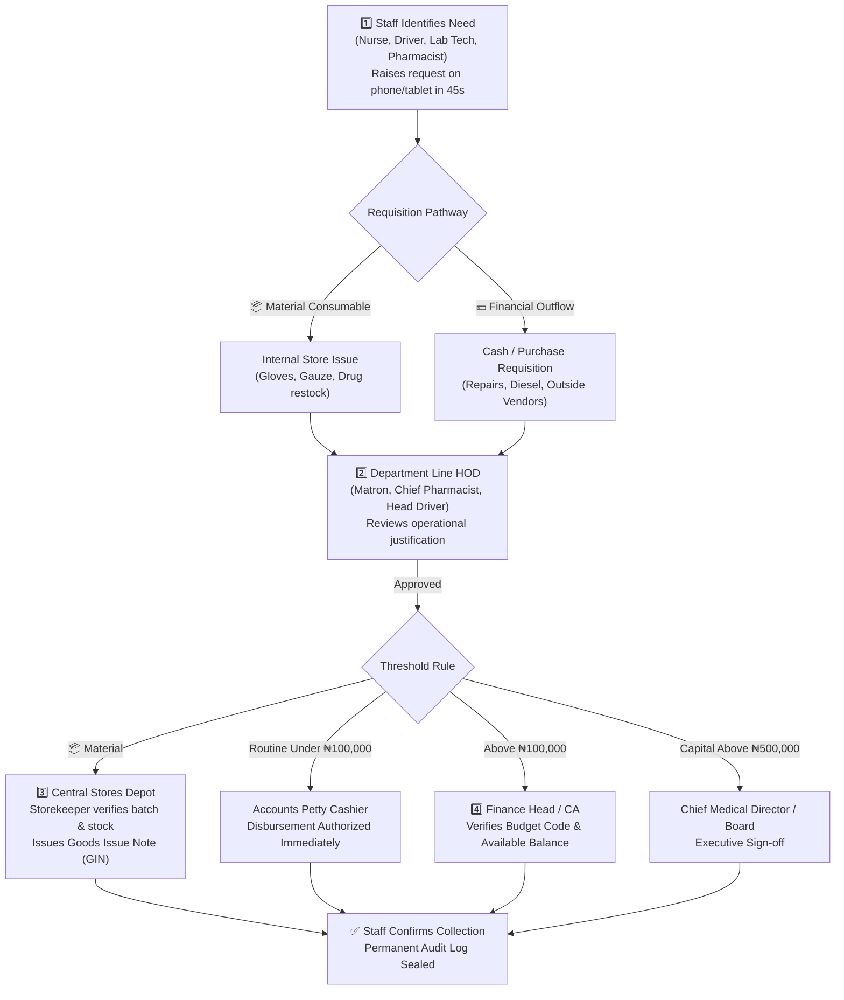

# 🏥 AMACREST HOSPITAL & MATERNITY
## Digital Requisition & Departmental Approval Management System
### Operational Walkthrough & Management Review Guide

---

**Prepared for:** The Chartered Accountant & Management Team, AMACREST Hospital & Maternity  
**Platform URL:** `https://amacrest-medreq.vercel.app` (or your active Vercel link)  
**Objective:** Operational Evaluation & Workflow Alignment  

---

## 1. 🎯 Purpose of This Review

This interactive prototype demonstrates a digital solution specifically built to eliminate paper requisition memos, prevent clinical bottlenecks, and give executive management real-time spending and inventory control.

The system is organized around two operational realities:
- **Authority starts with the direct departmental Line Manager (HOD).**
- **Internal material transfers from the central warehouse are cleanly separated from cash payments leaving the hospital bank account.**

---

## 2. 🗺️ The Hospital Workflow (How Data & Approvals Move)

### The 3 Core Rules Built into the Workflow:
1. **The Line Manager Rule:** Every request must originate from and be approved by the staff's direct departmental HOD. Top management is not burdened with micro-approvals for routine operational needs.
2. **The Dual Pathway Split:**
   - **Material Requisitions (80% of hospital volume):** Wards pulling consumables from Central Stores. *Zero cash is touched; warehouse stock is decremented.*
   - **Cash / Purchase Requisitions (20% of volume):** External purchases, emergency vehicle maintenance, diesel. *Touches budget codes and Accounts Payable.*
3. **Automatic Escalation:** Routine expenses under ₦100,000 fly quickly; mid-tier expenses route to Finance; capital items over ₦500,000 auto-escalate to the Chief Medical Director.

---

## 3. 🔍 Step-by-Step Testing Guide (For the Evaluator)

To evaluate the system as your staff, HODs, and finance team would:

### Step 1: Access the Workstation
- Open the platform URL on any smartphone, tablet, or laptop.
- Click **"Launch Workstation"** (or go to `/login`) to see the **One-Click Hospital Login Gateway**.

### Step 2: Test as Frontline Staff (Raising a Request)
- Sign in as **Malam Ibrahim (Ambulance Lead Driver)** or **Nurse Fatima (Ward 3 Senior Nurse)**.
- Tap **`+ New Requisition`**.
- Notice the two pathway cards:
  - Select **`📦 Internal Store Issue (Material)`** for ward supplies.
  - Select **`💵 Financial Disbursement (Cash PO)`** for vehicle repairs or external purchases.
- Select your items from the catalog.
  *(If an item is unlisted, tap **`+ Item not listed? Add Custom Item`** to specify an item description and estimated price).*
- Type a brief justification note and tap **Submit**.

### Step 3: Test as Department HOD (Reviewing & Escalating)
- Switch profile or go to `/hod`.
- Notice that the inbox is strictly grouped by department:
  - **Dr. Chinedu Eze** sees *Pharmacy Services* only.
  - **Matron Beatrice Alao** sees *Clinical Nursing & Wards* only.
  - **Malam Ibrahim Musa** sees *Transport & Fleet* only.
- Review the incoming request:
  - For store items, the button reads **`[Approve & Send to Store]`** (routes directly to the warehouse).
  - For routine cash under ₦100k, the button reads **`[Approve Disbursement]`** (authorizes cashier payout).
  - For capital items over ₦500k, the button reads **`[Approve & Escalate]`** (routes to Finance and the CMD).

### Step 4: Test Stores & Inventory Management
- Go to `/inventory` to view the **Central Hospital Stock Register**.
- Review stock status badges (*In Stock, Low Stock, Out of Stock*) and safety reorder levels.
- Notice the **`Download CSV Template`** and **`Import CSV File`** options, which allow each department to onboard existing stock registers directly from Excel.

### Step 5: Test the Finance & Executive Control Room
- Go to `/finance`.
- Review the departmental budget progress bars (*Allocated vs. Spent vs. Committed*).
- Observe how the system tracks remaining budget allocations in real-time Naira before expenses occur.

---

## 4. 📝 Operational Review Questionnaire

Please review these 6 operational points with your team so we can align the system to AMACREST Hospital's exact structure:

1. **Department Structure:** Are there specific clinical or administrative units currently missing? *(e.g., Theatre, Dialysis Unit, Billing, NHIA Desk, Security?)*
2. **Financial Thresholds:** In the prototype, we set routine approval at **₦100,000** (Line HOD), mid-tier at **₦100,000–₦500,000** (Finance/CA), and capital at **above ₦500,000** (CMD). What are AMACREST Hospital's exact financial authorization limits?
3. **Disbursement Method:** How does the hospital currently disburse approved petty cash for drivers and emergency maintenance? *(Cashier cash desk, direct bank transfer, or corporate card?)*
4. **Stores Replenishment:** How does Central Stores currently track ward floor-stock replenishment?
5. **Delegation / Proxy Sign-Off:** When an HOD is in surgery, on night call, or on annual leave, who holds secondary approval rights?
6. **Operational Blind Spots:** Are there any unique administrative bottlenecks, vendor payment challenges, or hospital-specific workflows you would like addressed?

---

*AMACREST Hospital & Maternity · Digital Requisition & Approval Management System*
